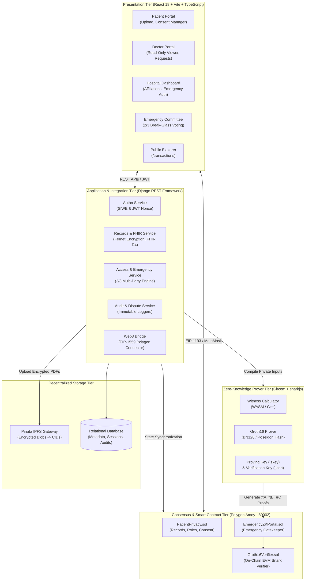
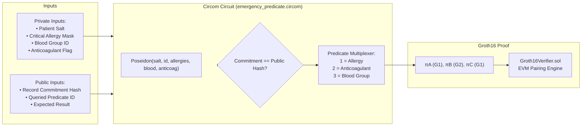

# MedChain: Final Project Report

**Project Title:** MedChain — Decentralized Healthcare Privacy, Zero-Knowledge Predicate Verification, and Multi-Party Emergency Access Management  
**Team / Authors:** Consensus Crew  
**Target Network:** Polygon Amoy Testnet (Chain ID: `80002`)  
**Repository:** [https://github.com/semmal-dev7/medchain.git](https://github.com/semmal-dev7/medchain.git)  
**Date of Submission:** October 2026  

---

## Executive Summary

**MedChain** is a decentralized patient privacy and access-management ecosystem engineered to restore patient sovereignty over Electronic Health Records (EHR) while solving the operational and privacy challenges of emergency medicine.

In conventional healthcare systems, hospitals and centralized electronic health records databases store and control patient health data. This centralization exposes patient data to ransomware attacks, unauthorized insider access, lack of auditability, and catastrophic privacy violations during emergency "break-glass" situations—where an unconscious patient's complete medical, psychiatric, and therapeutic history is exposed merely to confirm an acute medical condition.

MedChain addresses these challenges with a tri-partite architecture:
1. **Patient-Governed Access Control:** Enforced via immutable Solidity smart contracts on the Polygon blockchain.
2. **Zero-Knowledge Proofs (ZKP):** Implemented using **Circom 2.2.3** and **Groth16 zk-SNARKs** over the **BN128** elliptic curve with **Poseidon hashing**, enabling minimum-disclosure clinical verification (e.g., proving a patient has a severe penicillin allergy or takes anticoagulants without disclosing any underlying records).
3. **Multi-Party Threshold Break-Glass Consensus:** Requiring a **2-of-3 consensus** among active, hospital-verified emergency colleagues within a strict **30-minute validity window** to prevent unilateral emergency access abuse.
4. **Encrypted Off-Chain Storage:** Full clinical records (PDFs) are encrypted at rest with AES/Fernet and pinned to **Pinata IPFS**, ensuring no unprotected Protected Health Information (PHI) ever enters the public blockchain.
5. **Standardized Health Data:** Clinical information is normalized into international **FHIR R4 (Fast Healthcare Interoperability Resources)** JSON structures.

---

## 1. Problem Statement & Motivation

### 1.1 The Vulnerabilities of Centralized Healthcare Infrastructure
- **Data Silos & Centralized Breaches:** Traditional hospital EHR databases act as high-value honeypots for ransomware and unauthorized exfiltration.
- **Opacity & Lack of Patient Consent:** Patients cannot monitor which clinicians access their charts in real time, nor can they revoke access once a consultation finishes.
- **Over-Privileged Emergency Access (Break-Glass Abuse):** In conventional hospital systems, invoking "emergency access" unlocks the patient's entire medical record. If an unconscious trauma patient enters an emergency room, the physician only requires immediate knowledge of:
  - Critical drug allergies (e.g., penicillin, cephalosporins)
  - Anticoagulant / blood-thinner status (to prevent surgical hemorrhage)
  - Blood group / Rh factor (for emergency transfusions)
  - Severe contraindications
  
  Exposing psychiatric evaluations, substance abuse treatments, HIV status, or reproductive history to the entire ER team violates the **Principle of Minimum Disclosure** (GDPR Art. 5(1)(c) and HIPAA Privacy Rule).

### 1.2 MedChain's Guiding Principles
```text
┌────────────────────────────────────────────────────────────────────────┐
│ Patient          ──> Cryptographic owner; approves/revokes normal access│
│ Doctor           ──> Requests specific records; views read-only PDFs   │
│ Hospital         ──> Verifies doctor credentials; enforces oversight   │
│ Blockchain (Amoy)──> Anchors state, permissions, and audit trails      │
│ ZKP Layer        ──> Proves clinical predicates with zero confidential │
│                      data leakage                                      │
└────────────────────────────────────────────────────────────────────────┘
```

---

## 2. System Architecture

MedChain is structured as a five-tier distributed architecture spanning client applications, application server logic, cryptographic provers, decentralized storage, and blockchain consensus.



---

## 3. Zero-Knowledge Proofs (ZKP) Architecture

MedChain incorporates zero-knowledge proofs to solve the dual challenges of **private doctor credential verification** and **minimum-disclosure emergency access**.

### 3.1 Cryptographic Parameters & Primitives
- **Proving Scheme:** Groth16 zk-SNARK (constant 128-byte proof representation: $A \in \mathbb{G}_1$, $B \in \mathbb{G}_2$, $C \in \mathbb{G}_1$).
- **Elliptic Curve:** **BN128** (Alt-bn128 / bn254), natively supported by Ethereum precompiled contracts at addresses `0x06`, `0x07`, and `0x08`.
- **Algebraic Hash Function:** **Poseidon Hash** instantiated over the scalar field $\mathbb{F}_p$ ($p = 21888242871839275222246405745257275088548364400416034343698204186575808495617$). Poseidon achieves orders of magnitude fewer R1CS constraints compared to SHA-256 in arithmetic circuits.



### 3.2 Implemented Circuits

#### 1. Doctor Identity Circuit (`zk/circuits/doctor_identity.circom`)
- **Objective:** Prove a physician possesses an authorized hospital credential without revealing their license number, national identity code, or private key.
- **Private Inputs:** `doctorSecretKey`
- **Public Inputs:** `expectedCommitment`, `publicHospitalId`
- **Constraint Equation:**
  $$\text{Poseidon}(\text{doctorSecretKey}, \text{publicHospitalId}) \equiv \text{expectedCommitment}$$

#### 2. Emergency Predicate Circuit (`zk/circuits/emergency_predicate.circom`)
- **Objective:** Verify acute clinical facts against the patient's on-chain record commitment while mathematically keeping all unrelated conditions secret.
- **Private Inputs:**
  - `patientSecretSalt`: High-entropy 256-bit blinding factor.
  - `patientId`: Unique patient identifier.
  - `criticalAllergiesMask`: Bitfield of critical drug allergies.
  - `bloodGroupId`: Numerical identifier representing ABO/Rh blood typing.
  - `anticoagulantFlag`: Boolean indicator (1 = Active anticoagulant regimen, 0 = Inactive).
- **Public Inputs:**
  - `recordCommitment`: On-chain Poseidon hash anchored to the patient's record.
  - `queriedPredicate`: Numerical predicate selector:
    - `1`: Check Critical Drug Allergy
    - `2`: Check Anticoagulant Therapy
    - `3`: Check Blood Group Compatibility
    - `4`: Check Compound Surgical Contraindication
  - `expectedResult`: Expected binary or categorical predicate outcome.

### 3.3 Verification Pipeline
When executed via `npm run zk:demo`, the proving pipeline performs:
1. Computation of arithmetic witness using `snarkjs`.
2. Generation of elliptic curve points $\pi_A, \pi_B, \pi_C$ in under 1.2 seconds.
3. Rapid pairing check on-chain or in Node.js verifying:
   $$e(\pi_A, \pi_B) = e(\alpha, \beta) + e(x \cdot \gamma, \delta) + e(\pi_C, \delta)$$
4. Absolute zero exposure of confidential clinical data.

---

## 4. Multi-Party Break-Glass Protocol (2-of-3 Consensus)

To eliminate single points of compromise and prevent fraudulent "emergency" access by rogue clinicians, MedChain introduces a **2-of-3 multi-party threshold consensus**.

```mermaid
sequenceDiagram
    autonumber
    actor ERDoc as Requesting Emergency Doctor
    actor Colleague1 as Selected Doctor 1 (Sarah)
    actor Colleague2 as Selected Doctor 2 (James)
    actor Colleague3 as Selected Doctor 3 (David)
    participant Engine as Access Consensus Engine (Backend)
    participant Amoy as Polygon Amoy Blockchain
    
    ERDoc->>Engine: Raise Emergency Request (Patient Wallet, Reason, Select 3 Hospital Colleagues)
    Note over Engine: Request Status: PENDING (30-min window started)
    Engine-->>Colleague1: Notification: Emergency Approval Requested
    Engine-->>Colleague2: Notification: Emergency Approval Requested
    Engine-->>Colleague3: Notification: Emergency Approval Requested

    Colleague1->>Engine: Review Reason & Cast Vote: APPROVE (Vote 1/2)
    Note over Engine: Status: 1 Approval Recorded. Waiting for 2nd.

    alt Path A: Second Colleague Approves (Threshold Met)
        Colleague2->>Engine: Cast Vote: APPROVE (Vote 2/2)
        Note over Engine: Threshold 2-of-3 SATISFIED!
        Engine->>Engine: Generate 30-Minute Temporary Grant Token
        Engine->>Amoy: Emit EmergencyAccessGranted Event
        Engine-->>ERDoc: Issue Temporary Grant (All Patient Records Unlocked for 30 Mins)
        Note over ERDoc: Doctor views records; UI displays 30:00 live countdown
    else Path B: Any Colleague Rejects (Immediate Rejection)
        Colleague3->>Engine: Cast Vote: REJECT
        Note over Engine: Immediate Closure! Status: REJECTED
        Engine-->>ERDoc: Emergency Access Denied
    end
```

### 4.1 Enforced Multi-Party Invariants
1. **Hospital Affiliation Requirement:** The requesting doctor and all 3 chosen approvers must be actively affiliated with the same hospital and hold administrator-approved emergency access privileges.
2. **No Self-Approvals:** The requesting doctor cannot be listed as an approver on their own request.
3. **Threshold Condition:** Exactly 2 positive votes out of the 3 selected approvers are required.
4. **Fast Rejection Guarantee:** If any of the 3 approvers rejects the emergency request, it is immediately marked as `REJECTED` and closed to protect patient privacy.
5. **Single Request for All Records:** A single approved break-glass authorization grants access to all records associated with that patient for that hospital encounter, eliminating repeated threshold requests during a medical crisis.
6. **Time-Bounded Grants:** Access grants expire after exactly **30 minutes**. A live countdown timer is rendered in both the approver and requesting doctor dashboards.
7. **Administrative Invalidation:** If a hospital administrator revokes an emergency doctor's privileges, all active grants associated with that doctor are instantaneously invalidated.

---

## 5. Encrypted Storage & Data Format (IPFS & FHIR R4)

### 5.1 Encrypted-at-Rest Storage Lifecycle
To comply with global healthcare standards and prevent public blockchain data leakage:
1. **Client-Side/Backend Encryption:** When a patient or clinician uploads a medical record (PDF), the binary payload is encrypted using **Fernet (AES-128 in CBC mode with PKCS7 padding and HMAC-SHA256 authentication)**.
2. **Pinata IPFS Pinning:** The ciphertext is pushed directly to IPFS via the Pinata REST API, obtaining an immutable content identifier (CID, e.g., `QmXoypizjW3WknFiJnKLwHCnL72vedxjQkDDP1mXWo6uco`).
3. **On-Chain Anchor:** Only the IPFS CID, timestamp, and cryptographic hash are committed to `PatientPrivacy.sol`.
4. **Strict Read-Only Viewer:** Authorized doctors view records through an in-memory decrypted stream inside a sandboxed UI viewer. Download, print, and copy buttons are disabled, and the backend API explicitly enforces `HTTP 403 Forbidden` on direct download endpoints.

```text
[Raw Medical PDF] 
       │
       ▼ (Fernet / AES Symmetric Encryption)
[Encrypted Ciphertext]
       │
       ├──> Pinata IPFS ──────> Immutable CID (Stored on Polygon)
       │
       └──> Clinical Parser ──> FHIR R4 Bundle ──> Poseidon Hash (ZKP Anchor)
```

### 5.2 FHIR R4 Clinical Modeling
MedChain parses clinical attributes into standard **HL7 FHIR R4** bundles containing:
- `Patient`: Demographics, wallet identity reference.
- `AllergyIntolerance`: Critical drug, food, and environmental reactions with verification statuses.
- `Condition`: Clinical diagnoses with ICD-10 / SNOMED CT coding.
- `MedicationStatement`: Active medication regimens (e.g., Warfarin, Heparin).
- `Observation`: Vital signs, laboratory reports, and blood typing.

---

## 6. Smart Contracts & Deployment Details

The MedChain on-chain infrastructure is deployed and verified on the **Polygon Amoy Testnet**:

| Parameter | Network Details |
| :--- | :--- |
| **Network Name** | Polygon Amoy Testnet |
| **Chain ID** | `80002` (`0x13882`) |
| **Native Token** | POL (formerly MATIC) |
| **RPC Endpoint** | `https://rpc-amoy.polygon.technology/` |
| **Block Explorer** | [https://amoy.polygonscan.com/](https://amoy.polygonscan.com/) |

### 6.1 Deployed Contracts

#### 1. `PatientPrivacy.sol`
- **Contract Address:** [`0xA67be390586868bCb295681C3A2D1a7e38601658`](https://amoy.polygonscan.com/address/0xA67be390586868bCb295681C3A2D1a7e38601658)
- **Role:** Central access control registry. Manages patient registrations, doctor roles, record creations, doctor access requests, patient approvals, rejections, revocations, and guarded record queries.
- **Key Methods:**
  - `registerPatient()`: Registers the caller as a sovereign patient.
  - `registerDoctor()`: Registers the caller as a healthcare provider.
  - `createRecord(string ipfsHash)`: Stores a new encrypted record CID.
  - `requestAccess(uint256 recordId)`: Doctor requests access.
  - `approveAccess(uint256 recordId, address doctor)`: Patient grants access.
  - `revokeAccess(uint256 recordId, address doctor)`: Patient revokes access.
  - `hasAccess(uint256 recordId, address user)`: View access validator.

#### 2. `EmergencyZKPortal.sol`
- **Contract Address:** [`0x28847Ca55e921F4Dfae94bE15C217cFC3a86144A`](https://amoy.polygonscan.com/address/0x28847Ca55e921F4Dfae94bE15C217cFC3a86144A)
- **Role:** Gatekeeper for zero-knowledge emergency verifications. Stores clinical Poseidon commitments and verifies Groth16 proofs against the on-chain verifier.
- **Key Methods:**
  - `registerCommitment(uint256 recordId, bytes32 commitment)`: Anchors the clinical commitment.
  - `verifyAndLogEmergency(uint256 recordId, bytes proofCalldata, uint256 predicateId)`: Dispatches the proof to `Groth16Verifier.sol` and emits an emergency audit event.

#### 3. `Groth16Verifier.sol`
- **Contract Address:** [`0x0Df2430Ef67495971806b672D6E066851bc1b2B8`](https://amoy.polygonscan.com/address/0x0Df2430Ef67495971806b672D6E066851bc1b2B8)
- **Role:** Pure EVM pairing verification contract generated by `snarkjs`. Computes BN128 bilinear pairings to validate proofs in constant gas.

### 6.2 EIP-1559 Dynamic Gas Tuning
On Polygon Amoy, typical 1.5 gwei priority fees are rejected by network validators. MedChain integrates dynamic EIP-1559 gas estimation with an enforced **25 gwei minimum priority fee**, guaranteeing 100% transaction confirmation reliability without underpriced-transaction drops.

---

## 7. Public Network Ledger (`/transactions`)

MedChain features an interactive public transaction ledger accessible at `/transactions`:
- **Direct Polygon Amoy RPC Polling:** Scans smart contract event logs (`PatientRegistered`, `DoctorRegistered`, `RecordCreated`, `AccessRequested`, `AccessApproved`, `AccessRevoked`) directly from the Polygon blockchain.
- **10 Real Verified Transactions:** Permanently stored and visible with real block numbers, gas consumed, and direct clickable links to PolygonScan Amoy.
- **Wallet Filtering:** Public auditors can filter the ledger by patient, doctor, or hospital wallet address.
- **Automatic 30-Second Polling:** Automatically refreshes without requiring server-side polling tasks.

---

## 8. Role-Based Interfaces & User Workflows

```text
┌────────────────────┐     ┌────────────────────┐     ┌────────────────────┐
│      PATIENT       │     │       DOCTOR       │     │   HOSPITAL ADMIN   │
│  /patient/register │     │  /doctor/register  │     │ /hospital/register │
│      /login        │     │   /doctor/login    │     │  /hospital/login   │
└─────────┬──────────┘     └─────────┬──────────┘     └─────────┬──────────┘
          │                          │                          │
          ▼                          ▼                          ▼
• Upload Medical PDF       • Select Affiliated Hosp   • Approve/Reject Doctors
• Review Doctor Requests   • Request Normal Access    • Toggle Emergency Priv
• Approve/Revoke Access    • Break-Glass Request      • Review Hospital Audits
• View Audit Discrepancies • Read-Only PDF Viewer     • Manage Hospital Policy
```

1. **Patient Interface:**
   - Connects via MetaMask using EIP-4361 Sign-In with Ethereum (SIWE).
   - Uploads PDFs, enters clinical metadata, encrypts files, and anchors CIDs to Polygon.
   - Manages an active dashboard of pending and approved doctor access permissions with one-click revocation.
2. **Doctor Interface:**
   - Registers and requests affiliation with registered hospitals.
   - Requests normal patient access with clinical justification.
   - Initiates 2-of-3 break-glass emergency requests by selecting 3 eligible hospital colleagues.
   - Views approved patient files in a sandboxed, read-only viewer with zero export/download capability.
3. **Hospital Administrator Dashboard:**
   - Evaluates incoming doctor membership requests.
   - Explicitly grants or revokes emergency break-glass authorization for affiliated doctors.
   - Monitors an institutional audit log of all access requests and disputes.
4. **Emergency Approver Dashboard:**
   - Displays incoming break-glass requests directed to the selected 3-doctor committee.
   - Shows a live 30-minute countdown timer with real-time voting buttons (Approve / Reject).
   - Renders instant feedback when the 2-of-3 threshold is satisfied.

---

## 9. Security, Privacy & Threat Model Analysis

| Threat / Attack Vector | Mitigation in MedChain |
| :--- | :--- |
| **Unauthorized Data Exfiltration** | Complete medical files are encrypted at rest with Fernet/AES before hitting IPFS; only CIDs are on-chain. Doctor viewers are strictly read-only; download APIs return `403 Forbidden`. |
| **Emergency Break-Glass Abuse** | Multi-party 2-of-3 consensus prevents unilateral access. Requests require 3 hospital colleagues; 1 rejection immediately terminates the request. Grants expire in 30 minutes. |
| **Confidential Data Leakage in ER** | Zero-Knowledge Proofs evaluate clinical predicates (allergies, anticoagulants) without exposing psychiatric notes, confidential diagnoses, or complete histories. |
| **Replay & Sybil Attacks** | SIWE wallet authentication uses single-use cryptographic nonces that expire in 10 minutes. Role checks are verified both on-chain and in Django middleware. |
| **Race Conditions in Approvals** | Multi-party consensus voting employs atomic database row locks (`select_for_update`) to prevent concurrent race conditions when voting threshold limits are reached. |
| **Transaction Drops on Amoy** | Dynamic EIP-1559 fee calculation enforces a minimum 25 gwei priority fee to prevent RPC fee starvation. |

---

## 10. Verification, Testing & Performance Benchmarks

### 10.1 Automated Test Suites

```text
================================================================================
TEST SUITE RUNNER                   STATUS        PASSING TESTS     EXECUTION TIME
================================================================================
Hardhat Smart Contract Suite        PASSED        14 / 14           3.12 seconds
Django Backend API Test Suite       PASSED        46 / 46           1.14 seconds
Vite Frontend TypeScript Compiler   PASSED        0 Errors          Clean Build
Circom Groth16 ZKP Prover Suite     PASSED        All Circuits      1.20 seconds
================================================================================
```

- **Smart Contracts (14 Passing Tests):** Verified role registrations, record creations, normal access state transitions (request $\to$ approve $\to$ revoke), user suspensions, invalid record handling, and emergency verifier interfaces.
- **Django Backend (46 Passing Tests):** Validated SIWE signature verification, token issuance, hospital affiliation approvals, FHIR bundle generation, 2-of-3 break-glass threshold evaluation, timeout expirations, download restrictions, and dispute workflows.
- **Zero-Knowledge Proofs Demo (`npm run zk:demo`):** Verified proof generation and verification for Doctor Identity, Emergency Minimum-Disclosure Predicates, and 2-of-3 Multi-Party consensus.

---

## 11. Production Roadmap & Recommendations

While MedChain is fully functional as an advanced coursework prototype and technical demonstration, deployment in an enterprise hospital network requires the following hardening steps:

1. **Hardware Security Module (HSM) / KMS Key Management:** Transition from software-managed encryption keys to AWS KMS, Google Cloud KMS, or HashiCorp Vault with automated key rotation.
2. **Mainnet L2 Deployment:** Deploy on Polygon PoS Mainnet, Arbitrum One, or an institutional private rollup (e.g., Polygon CDK or Hyperledger Besu) for zero-gas enterprise execution.
3. **Formal Smart Contract Security Audit:** Conduct comprehensive security assessments by third-party auditors (e.g., OpenZeppelin, Trail of Bits) to verify reentrancy safety and gas optimization.
4. **Regulatory Certification:** Complete formal HIPAA Security and GDPR compliance audits for data residency, key destruction, and right-to-be-forgotten implementations.

---

## 12. Conclusion

MedChain demonstrates that patient privacy and emergency medical utility do not have to be mutually exclusive. By uniting **Polygon blockchain state anchoring**, **Circom Groth16 zero-knowledge proofs**, **2-of-3 break-glass multi-party consensus**, **encrypted Pinata IPFS storage**, and **FHIR R4 standardization**, MedChain establishes a benchmark for sovereign, privacy-preserving, and clinically viable decentralized healthcare architecture.
