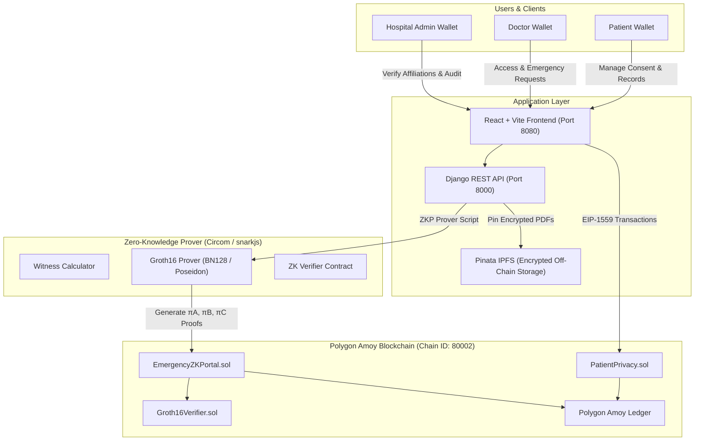

# MedChain: Decentralized Healthcare Privacy & Zero-Knowledge Emergency Access

[](https://amoy.polygonscan.com/)
[](https://iden3.io/circom)
[-blue?style=for-the-badge&logo=ipfs)](https://pinata.cloud)
[](https://hl7.org/fhir/)
[](https://www.djangoproject.com/)
[](https://vitejs.dev/)

MedChain is a decentralized patient privacy and access-management system designed for healthcare networks. Patients maintain cryptographic ownership of their medical records, doctors request granular access, hospitals manage organizational identity and doctor affiliations, and an emergency break-glass protocol utilizes **Zero-Knowledge Proofs (ZKP)** and **2-of-3 multi-party threshold consensus** to grant time-bounded emergency access without disclosing confidential patient history.

---

## Table of Contents

1. [Key Features](#key-features)
2. [Core Architecture & Protocols](#core-architecture--protocols)
   - [Normal Consultation Protocol](#1-normal-consultation-protocol)
   - [Emergency Break-Glass Protocol (2-of-3 Consensus)](#2-emergency-break-glass-protocol-2-of-3-consensus)
   - [Zero-Knowledge Proofs (ZKP) Architecture](#3-zero-knowledge-proofs-zkp-architecture)
   - [Encrypted Off-Chain Storage (Pinata IPFS)](#4-encrypted-off-chain-storage-pinata-ipfs)
   - [Public Network Ledger](#5-public-network-ledger)
3. [Smart Contracts & Deployment](#smart-contracts--deployment)
4. [Project Structure](#project-structure)
5. [Quick Start & Local Development](#quick-start--local-development)
   - [1. Smart Contracts](#1-smart-contracts)
   - [2. Zero-Knowledge Proofs Demo](#2-zero-knowledge-proofs-demo)
   - [3. Django REST Backend](#3-django-rest-backend)
   - [4. React + Vite Frontend](#4-react--vite-frontend)
6. [User Workflows & Interfaces](#user-workflows--interfaces)
7. [Security & Privacy Guarantees](#security--privacy-guarantees)
8. [Testing & Validation](#testing--validation)

---

## Key Features

- **Patient-Centric Sovereignty:** Patients own their health data commitments on the Polygon blockchain and approve, reject, or revoke doctor access on-chain.
- **Zero-Knowledge Proofs (Circom 2.2.3 + Groth16 zk-SNARKs):**
  - **Doctor Identity Verification:** Proves doctor credentials and hospital affiliation with zero leakage of private doctor license or identification keys.
  - **Emergency Minimum-Disclosure Predicates:** Proves critical medical conditions (e.g., severe drug allergies, anticoagulants, blood groups) directly against Polygon-anchored commitments without revealing confidential diagnoses or psychiatric records.
- **2-of-3 Break-Glass Emergency Consensus:**
  - Emergency doctors select 3 active, hospital-verified emergency colleagues.
  - Requires **2 out of 3 distinct approvals** within a strict **30-minute window**.
  - Rejection by any selected doctor immediately closes the request.
  - A single approved emergency request grants access to all records of the patient for a time-limited 30-minute window with a live countdown timer.
- **Encrypted Off-Chain Storage (Pinata IPFS):**
  - All medical records (PDFs) are encrypted at rest with Fernet/AES before upload to Pinata IPFS. Only content identifiers (CIDs) and Poseidon/SHA-256 commitments reside on-chain.
  - Doctors view records in a strictly read-only, non-downloadable viewer; the backend API explicitly rejects download attempts with `HTTP 403 Forbidden`.
- **FHIR R4 Healthcare Normalization:** Structured clinical data is mapped into standard FHIR R4 bundles (`AllergyIntolerance`, `Condition`, `MedicationStatement`, `Observation`, `DiagnosticReport`).
- **Interactive Public Network Ledger (`/transactions`):** Real-time public audit page streaming on-chain contract events and linking verified transactions directly to the PolygonScan Amoy explorer.

---

## Core Architecture & Protocols



---

### 1. Normal Consultation Protocol

```text
Doctor Request -> Patient Notification -> Patient On-Chain Approval -> Read-Only Record Access -> Patient Revocation
```

1. **Doctor Request:** An active doctor affiliated with an approved hospital submits an access request for a specific patient record.
2. **Patient Review:** The patient inspects the doctor's identity, hospital affiliation, and request reason on the patient dashboard.
3. **On-Chain Approval:** The patient signs an on-chain transaction calling `approveAccess(recordId, doctor)` on `PatientPrivacy.sol`.
4. **Guarded View:** The doctor views the decrypted PDF in a read-only viewer. Printing and downloading are blocked at the UI and API layers.
5. **Revocation:** The patient can revoke access at any time via an on-chain transaction calling `revokeAccess(recordId, doctor)`.

---

### 2. Emergency Break-Glass Protocol (2-of-3 Consensus)

In emergency scenarios where a patient is unconscious or unable to give consent:

```mermaid
sequenceDiagram
    autonumber
    actor ERDoc as Emergency Doctor
    actor Approvers as 3 Selected ER Doctors
    participant Backend as Django REST Backend
    participant ZKP as Circom Groth16 Prover
    participant Amoy as Polygon Amoy (EmergencyZKPortal)
    
    ERDoc->>Backend: Create Emergency Request (Patient, Reason, 3 Selected Approvers)
    Backend-->>Approvers: Notify 3 Selected Hospital Doctors
    Note over Approvers: 30-Minute Break-Glass Window Begins
    Approvers->>Backend: Doctor 1 Approves (Vote 1/2)
    Approvers->>Backend: Doctor 2 Approves (Vote 2/2 - Threshold Met!)
    Backend->>ZKP: Generate Zero-Knowledge Predicate Proof (Poseidon Hash)
    ZKP->>Amoy: Verify Groth16 Proof on EmergencyZKPortal.sol
    Amoy-->>Backend: Proof Verified on-chain
    Backend-->>ERDoc: Issue 30-Minute Temporary Access Grant
    Note over ERDoc: Doctor Views Patient Records with Live 30-Min Countdown
    ERDoc->>Backend: Access expires or is revoked; immutable audit logged
```

- **Consolidated Request:** A single emergency request covers all records of the emergency patient.
- **Threshold Policy:** Requires 2 distinct approvals from the 3 selected emergency doctors. If any selected doctor rejects, the request is immediately closed.
- **Time Window:** The grant is valid for exactly 30 minutes, backed by a live countdown timer in the frontend interface.

---

### 3. Zero-Knowledge Proofs (ZKP) Architecture

MedChain implements zero-knowledge proofs using **Circom 2.2.3** and the **Groth16 zk-SNARK** proving system over the **BN128** elliptic curve with **Poseidon** hashing:

| Component | Specification | Description |
| :--- | :--- | :--- |
| **Circuit Language** | Circom 2.2.3 | Arithmetic constraint systems |
| **Proving Protocol** | Groth16 zk-SNARK | Ultra-fast verification, constant 128-byte proof size |
| **Curve** | BN128 (Alt-bn128) | Native EVM pairing precompile support (`0x08`) |
| **Hash Function** | Poseidon | High-efficiency algebraic hash function for SNARKs |
| **Circuits** | `zk/circuits/` | `doctor_identity.circom`, `emergency_predicate.circom` |
| **Solidity Verifier** | `zk/contracts/` | `Groth16Verifier.sol` |

#### Supported ZK Predicates:
1. **Critical Drug Allergy:** Proves whether the patient has an allergy (e.g., penicillin) without revealing unrelated medical history.
2. **Anticoagulant Flag:** Verifies if the patient takes blood thinners to avoid hemorrhage during emergency surgery.
3. **Blood Group Matching:** Verifies compatibility for emergency blood transfusions.
4. **Emergency Contraindications:** Proves compound medical safety checks.

---

### 4. Encrypted Off-Chain Storage (Pinata IPFS)

To protect patient confidentiality and avoid storing raw personal health information (PHI) on a public blockchain:
1. Medical files (PDFs) are encrypted with Fernet symmetric keys at rest.
2. Encrypted files are uploaded to IPFS using the **Pinata API**.
3. Only the resulting IPFS **Content Identifier (CID)** and cryptographic commitments are recorded in smart contract state.
4. Read-only streaming endpoints decrypt records on-the-fly for authorized doctors. Downloads are blocked with `HTTP 403 Forbidden`.

---

### 5. Public Network Ledger

Available at `/transactions` on the web interface:
- Reads event logs directly from `PatientPrivacy.sol` on Polygon Amoy.
- Displays 10 real, verified on-chain transactions with clickable links to **PolygonScan Amoy**.
- Live polling updates every 30 seconds for newly confirmed transactions.
- Filter transactions by participant wallet address.

---

## Smart Contracts & Deployment

The smart contracts are deployed on the **Polygon Amoy Testnet** (Chain ID: `80002` / `0x13882`):

| Contract | Address | Network | Explorer |
| :--- | :--- | :--- | :--- |
| **`PatientPrivacy.sol`** | `0xA67be390586868bCb295681C3A2D1a7e38601658` | Polygon Amoy | [View on PolygonScan](https://amoy.polygonscan.com/address/0xA67be390586868bCb295681C3A2D1a7e38601658) |
| **`EmergencyZKPortal.sol`** | `0x28847Ca55e921F4Dfae94bE15C217cFC3a86144A` | Polygon Amoy | [View on PolygonScan](https://amoy.polygonscan.com/address/0x28847Ca55e921F4Dfae94bE15C217cFC3a86144A) |
| **`Groth16Verifier.sol`** | `0x0Df2430Ef67495971806b672D6E066851bc1b2B8` | Polygon Amoy | [View on PolygonScan](https://amoy.polygonscan.com/address/0x0Df2430Ef67495971806b672D6E066851bc1b2B8) |

---

## Project Structure

```text
medchain/
├── contracts/                        # Solidity smart contracts
│   ├── PatientPrivacy.sol            # Access control, records, consent management
│   ├── EmergencyZKPortal.sol         # Emergency ZKP verification boundary
│   └── MockGroth16Verifier.sol       # Development verifier contract
├── zk/                               # Zero-Knowledge Proof (Circom + Groth16) suite
│   ├── circuits/                     # Circom arithmetic circuits
│   │   ├── doctor_identity.circom    # Doctor privacy-preserving credential circuit
│   │   └── emergency_predicate.circom# Medical minimum-disclosure predicate circuit
│   ├── contracts/                    # Auto-generated Groth16 Solidity verifiers
│   │   └── Groth16Verifier.sol
│   ├── scripts/                      # ZKP proof generation and validation scripts
│   │   └── run_zkp_demo.js           # Full end-to-end ZKP demonstration
│   └── README.md                     # Dedicated ZKP documentation
├── backend/                          # Django REST Framework backend
│   ├── apps/
│   │   ├── authn/                    # SIWE wallet signature authentication & JWTs
│   │   ├── hospitals/                # Hospital directory, doctor affiliations, admin audit
│   │   ├── records/                  # Encrypted storage, FHIR bundles, commitments
│   │   ├── access/                   # Normal access, emergency requests & 2/3 consensus
│   │   └── audit/                    # Audit logging & dispute management
│   ├── config/                       # Django settings, URLs, WSGI
│   └── manage.py
├── frontend/                         # React + Vite + TypeScript frontend
│   ├── src/
│   │   ├── components/               # UI components (shadcn/ui, modals, viewer)
│   │   ├── pages/
│   │   │   ├── patient/              # Patient dashboard, upload, access manager
│   │   │   ├── doctor/               # Doctor dashboard, emergency requester, read-only viewer
│   │   │   ├── hospital/             # Hospital admin dashboard & approvals
│   │   │   ├── emergency/            # 2-of-3 Emergency approver committee dashboard
│   │   │   └── PublicTransactions.tsx# Public network ledger with PolygonScan links
│   │   ├── services/                 # API client, contracts ABI, wallet connection
│   │   └── App.tsx
└── README.md                         # Project documentation
```

---

## Quick Start & Local Development

### Prerequisites

- **Node.js**: v18.x or v20.x
- **Python**: v3.10+
- **MetaMask**: Configured for Polygon Amoy (Chain ID `80002`, RPC: `https://rpc-amoy.polygon.technology/`)

---

### 1. Smart Contracts

Install dependencies, compile contracts, and run the test suite:

```powershell
# From project root
npm install
npm run compile
npm run test
```

*Expected output: 14 passing tests covering patient registration, record lifecycle, permissions, and emergency portals.*

---

### 2. Zero-Knowledge Proofs Demo

Run the end-to-end ZKP suite to generate and verify Groth16 zero-knowledge proofs for doctor identity and patient emergency predicates:

```powershell
npm run zk:demo
```

---

### 3. Django REST Backend

Set up and start the Django API server:

```powershell
cd backend
python -m venv venv
venv\Scripts\activate   # On Linux/macOS: source venv/bin/activate
pip install -r requirements.txt
python manage.py migrate
python manage.py runserver 127.0.0.1:8000
```

Configure `.env` in `backend/` for Pinata IPFS uploads:

```env
IPFS_API_URL=https://api.pinata.cloud/pinning/pinFileToIPFS
IPFS_API_TOKEN=<your_pinata_jwt_token>
```

Run backend unit and integration tests:

```powershell
python manage.py test
```

*Expected output: 46 passing tests.*

---

### 4. React + Vite Frontend

Install frontend packages and start the Vite dev server:

```powershell
cd frontend
npm install
npm run start
```

Open `http://localhost:8080` in Chrome with MetaMask installed.

---

## User Workflows & Interfaces

| Role | Authentication Route | Key Capabilities |
| :--- | :--- | :--- |
| **Patient** | `/patient/register` & `/login` | Upload encrypted medical records, view access requests, approve/reject/revoke doctor access on-chain. |
| **Doctor** | `/doctor/register` & `/doctor/login` | Select hospital, submit membership request, request normal patient access, view approved records in read-only viewer. |
| **Hospital Admin** | `/hospital/register` & `/hospital/login` | Review doctor membership requests, enable/disable emergency authorization, inspect hospital audit logs. |
| **Emergency Approver** | `/emergency/approvals` | 2-of-3 multi-party voting on break-glass emergency requests within 30-minute window. |
| **Public Auditor** | `/transactions` | Public ledger of verified on-chain transactions linked to PolygonScan Amoy. |

---

## Security & Privacy Guarantees

1. **No Cleartext Medical Data On-Chain:** Only IPFS CIDs and Poseidon/SHA-256 commitments are anchored to Polygon.
2. **Strict Read-Only Doctor Viewer:** Doctors cannot download, print, or export patient records. Direct download API requests are rejected with `HTTP 403 Forbidden`.
3. **Emergency Minimum Disclosure:** Zero-knowledge proofs evaluate medical conditions (e.g., penicillin allergy) without exposing confidential records or psychiatric notes.
4. **Multi-Party Break-Glass Authorization:** Requires 2-of-3 consensus among hospital-authorized emergency colleagues to prevent unilateral emergency abuse.
5. **Time-Bounded Grants:** Emergency access automatically terminates after 30 minutes.
6. **EIP-1559 Dynamic Fees:** Transactions use a minimum 25 gwei priority tip to guarantee smooth execution on Polygon Amoy.

---

## Testing & Validation

The MedChain codebase is thoroughly tested across all layers:

- **Smart Contract Tests:** 14 unit tests via Hardhat (`npm run test`).
- **Backend Tests:** 46 automated tests covering SIWE authentication, hospital affiliation, FHIR normalization, 2-of-3 break-glass consensus, and audit trails (`python manage.py test`).
- **ZKP Verification:** Automated witness generation and Groth16 cryptographic proof verification (`npm run zk:demo`).
- **Frontend Quality:** Fully typed in TypeScript with clean production build (`npm run build`).

---

## License

This project was developed for educational and coursework demonstration purposes. All rights reserved.
